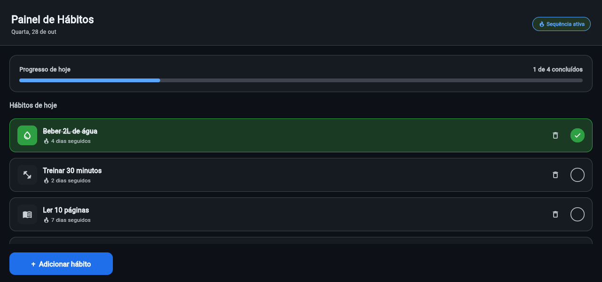

# Painel de Hábitos (Habit Tracker) · Flet Edition



Aplicação web e interativa de acompanhamento e gestão de hábitos diários, construída em **Python** utilizando o framework **Flet**. 

O projeto foi originalmente concebido pelo **Prof. Dr. Claiton de Oliveira** (UTFPR) como material prático de Front-end para a especialização *lato sensu* em **Python Avançado**, tendo recebido apenas algumas adaptações estruturais e de **containerização para suporte a deploy contínuo em ambiente serverless/cloud no Render**. 

---

## Tecnologias Utilizadas

- **Linguagem:** Python 3.10+
- **Framework de UI:** [Flet](https://flet.dev/) (baseado em Flutter e ASGI/FastAPI)
- **Containerização:** Docker
- **Hospedagem / Cloud:** [Render Web Services](https://render.com/)

---

## Funcionalidades

- **Dashboard Principal:**
  - Visualização de progresso diário em tempo real (barra e percentual dinâmicos).
  - Data atual formatada em português.
  - Indicador de sequência (streak) ativa.
- **Gerenciamento de Hábitos:**
  - Listagem de hábitos cadastrados.
  - Marcação/desmarcação de hábitos concluídos (com feedback visual e estético).
  - Remoção/exclusão de hábitos da lista.
- **Cadastro de Novos Hábitos:**
  - Formulário com campo para nome do hábito.
  - Seletor interativo de ícones visuais.
  - Validação de formulário.

---

## Como Executar Localmente

### Pré-requisitos
- Python 3.10 ou superior instalado.
- Git instalado.

### Passo a Passo

1. **Clone o repositório:**
   ```bash
   git clone https://github.com/area-41/Habitos-app.git
   cd Habitos-app
   ```

2. **Crie e ative um ambiente virtual (opcional, mas recomendado):**
   ```bash
   python -m venv venv
   # No Linux/macOS:
   source venv/bin/activate
   # No Windows:
   venv\Scripts\activate
   ```

3. **Instale as dependências:**
   ```bash
   pip install -r requirements.txt
   ```

4. **Execute a aplicação:**
   ```bash
   python habitos_app.py
   ```
   Acesse a aplicação no navegador em `http://localhost:10000` (ou na porta configurada).

---

## Executando com Docker

1. **Construir a imagem Docker:**
   ```bash
   docker build -t habitos-app .
   ```

2. **Rodar o container:**
   ```bash
   docker run -p 10000:10000 habitos-app
   ```
   Acesse `http://localhost:10000` em seu navegador.

---

# 🔄 Alterações Realizadas para Compatibilidade com o Render

Para migrar a aplicação de um ambiente desktop/local para uma hospedagem baseada em **Containers Docker no Render**, foram necessárias adaptações na infraestrutura, nas dependências e na sintaxe do código Flet (devido ao alinhamento com as versões mais recentes do framework).

### 1. Ajustes de Infraestrutura e Containerização (`Dockerfile` & `requirements.txt`)
- **Porta Dinâmica:** O Render injeta dinamicamente a variável de ambiente `PORT` no container. O ponto de entrada da aplicação foi atualizado para ler essa variável via `os.environ.get("PORT", 10000)`.
- **Modo Web Server Headless:** Removida a tentativa de abrir uma janela local (`view=ft.AppView.WEB_BROWSER`) em prol da execução como um servidor web ASGI puro (`view=None`, `host="0.0.0.0"`).
- **Conflito de Versões (FastAPI / Flet):** O pacote `Flet` utilizava chamadas a parâmetros descontinuados em versões recentes do `FastAPI` (como `openapi_prefix`). O `requirements.txt` foi ajustado para fixar o `fastapi<0.116.0` e usar uma versão estável do Flet (`flet>=0.25.0`), garantindo o build limpo na nuvem.

### 2. Refatoração e Modernização da API do Flet (`habitos_app.py`)
Com a atualização da biblioteca Flet nas dependências, ajustou-se o código legado para a sintaxe moderna do Flet:

| Componente/Ação | Sintaxe Antiga (Depreciada) | Sintaxe Atualizada (Render) |
| :--- | :--- | :--- |
| **Ícones** | `ft.Icons.WATER_DROP_OUTLINED` | `ft.icons.WATER_DROP_OUTLINED` |
| **Bordas Completa** | `ft.Border.all()` | `ft.border.all()` |
| **Bordas Unilaterais** | `ft.border(bottom=...)` | `ft.border.only(bottom=ft.BorderSide(...))` |
| **Alinhamento** | `ft.Alignment.CENTER` | `ft.alignment.center` |
| **Botões Elevados** | `ft.Button(...)` | `ft.ElevatedButton(...)` |

---

## 🌐 Deploy em Produção

A aplicação está atualmente hospedada no Render e acessível no seguinte endereço:
- **URL do App:** [https://habitos-app-bhd8.onrender.com](https://habitos-app-bhd8.onrender.com)